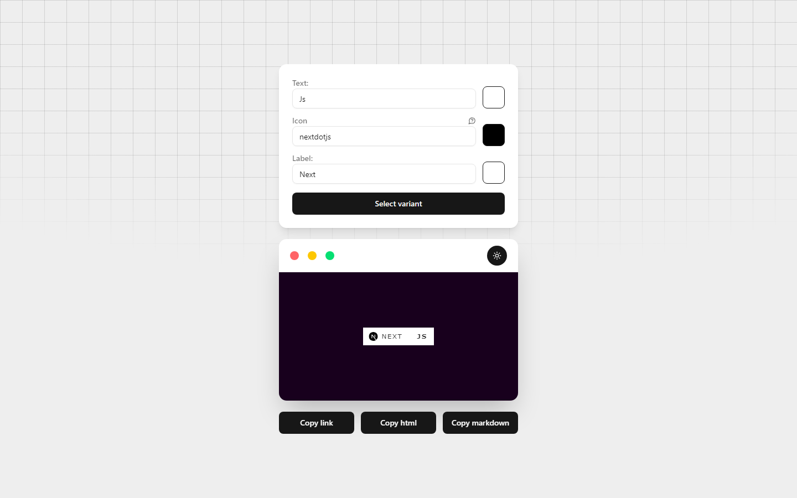

# My Custom Badge

Create and customize your own Shields.io badge, ready to copy into your README or docs.

[](LICENSE)



**Live:** <https://joao-carmassi.github.io/my-custom-badge/>

## Features

- Customize the badge text, text color, label and label color
- Add an icon from Simple Icons and set its color
- Pick one of five styles: for-the-badge, flat, flat-square, plastic or social
- Copy the badge as a direct link, HTML `` tag or Markdown
- Preview the badge live, with a light or dark background
- Remember your last badge in the browser (stored in localStorage)

## Tech stack

- [Next.js](https://nextjs.org/) 15 with the App Router, exported as a static site
- [React](https://react.dev/) 19 and [TypeScript](https://www.typescriptlang.org/)
- [Tailwind CSS](https://tailwindcss.com/) 4 with [shadcn/ui](https://ui.shadcn.com/)-style components on Radix UI
- [Shields.io](https://shields.io) API for rendering the badge
- [Simple Icons](https://simpleicons.org) for the icon set
- GitHub Pages for hosting

## Getting started

### Prerequisites

- Node.js 18.18 or later (LTS recommended)
- npm

### Install

```sh
git clone https://github.com/joao-carmassi/my-custom-badge.git
cd my-custom-badge
npm ci
```

## Usage

Start the development server:

```sh
npm run dev
```

Open http://localhost:3000, type your text, pick colors and an icon, choose a variant, then click **Copy link**, **Copy html** or **Copy markdown**.

To build the static site into `out/` (the sitemap is generated after the build):

```sh
npm run build
```

## Configuration

The subpath used by GitHub Pages is set in `.env.production`:

```sh
NEXT_PUBLIC_BASE_PATH=/my-custom-badge
```

Leave it empty (or remove the file) to serve the site from the root of a domain. The optional `SITE_URL` environment variable sets the base URL used by `next-sitemap`.

## Deployment

Pushing to `main` runs `.github/workflows/deploy.yml`, which builds the site with `next build` and publishes the `out/` folder to GitHub Pages. You can also trigger the workflow manually from the Actions tab.

## Credits

- [Shields.io](https://shields.io), whose API renders every badge
- [Simple Icons](https://simpleicons.org), the source of the icon names and logos
- [shadcn/ui](https://ui.shadcn.com/), the base for the UI components

## License

MIT - see [LICENSE](LICENSE).

---
Made by [João Carmassi](https://github.com/joao-carmassi)
